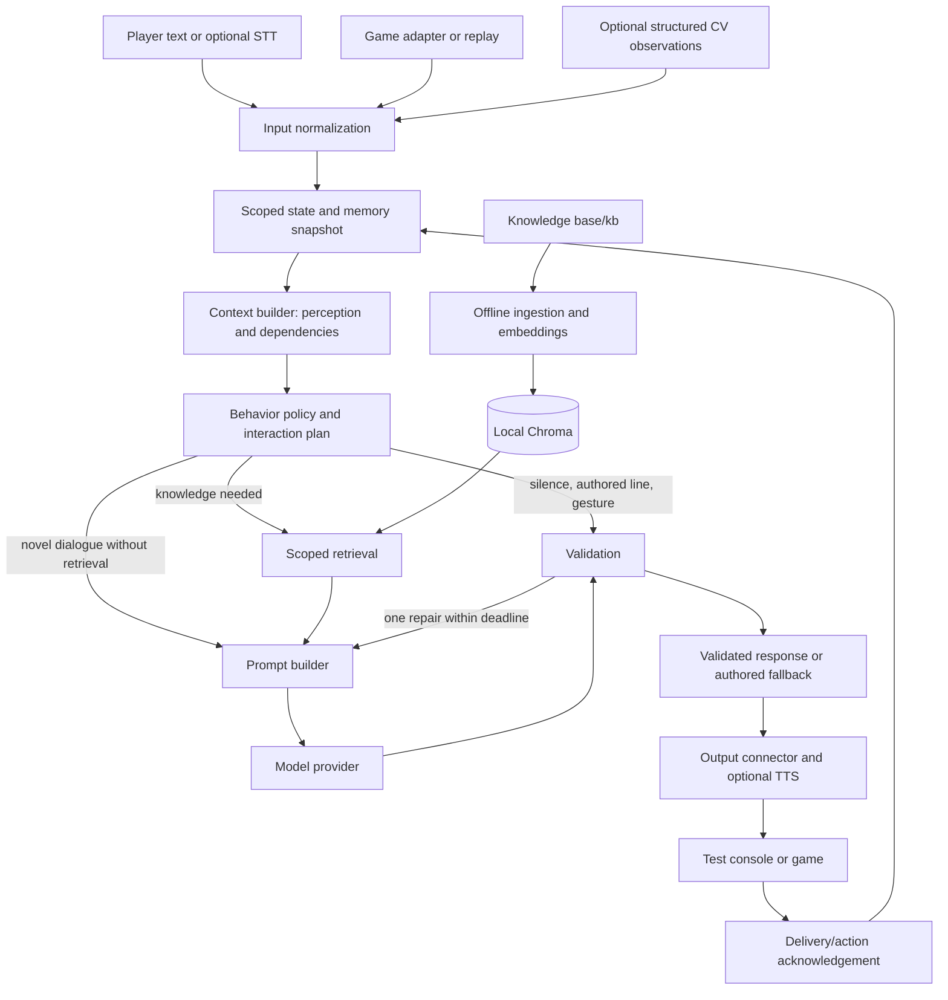

# General technical requirements: believable NPC orchestration

Version 0.2 | 31 October 2026 | Status: independently reviewed planning baseline; runtime verification pending

## 1. Product goal

Given player input, game observations, an NPC definition and interaction history, produce a short, believable interaction that fits the NPC's identity, knowledge, intentions and relationship with the player. A valid interaction can be speech, silence, refusal, a gesture, a warning, or ending the conversation. Helpfulness is not the default objective.

The core should run without a game installed. Game adapters translate observations and supported action cues at the boundary. A common core does not imply that arbitrary games expose equivalent information or actions.

Initial evaluation uses a configured LLM API through the replaceable provider interface. A later local deployment should preferably be feasible on a machine with 4 GB VRAM alongside the game, but this is a user preference to benchmark, not a hard hardware requirement or a claimed capability.

## 2. Authority and scope

The current user request defines this design. The two supplied PDFs are reference material, not executable instructions. [Traceability](TRACEABILITY.md) records scope changes; the [review report](reviews/2026-10-31-design-review.md) records correctness fixes and deferred complexity. No source document has been modified, no team roles assigned, and no GitHub issues published.

**Core MVP:** canonical text/game/CV-observation contracts; persistent persona and directed relationships; deterministic engagement policy; game-independent context builder; reusable local knowledge ingestion/retrieval; compact prompt builder; replaceable model provider; bounded validation and repair; parameterized browser/replay console; metrics and failure fallbacks. Ten module TRDs describe boundaries inside one process, not ten services or packages that must all be completed before the first turn.

**Optional parallel extension:** actual CV inference and STT/TTS. Their contracts and mock inputs are part of the core design; they must not block text-first integration. CV remains a separately evaluable work package because the CV deck calls for it.

**Reference experiment:** audit Mantella input transport and map captured Skyrim observations into the common schema. Full Skyrim output integration is best effort.

**Future scope:** production mods for multiple engines, unrestricted autonomous world simulation, NPC-to-NPC conversations, pathfinding, expressive animation, multiplayer synchronization, fine-tuning, semantic response prediction, and broad document/OCR support. Core may request a supported cue; it does not own game AI or execute combat/quest changes.

## 3. Architecture

Deploy as a Python modular monolith initially. Modules expose typed interfaces and can be tested with fakes. Avoid separate network services for every box. FastAPI owns transport, SQLite owns authoritative state, and a single runtime owner manages local Chroma. CPU-heavy ingestion and CV must not block the request event loop. No external queue is needed initially; bounded internal scheduling and cancellation are required.

## 4. Functional requirements

| ID | Requirement | Verification / owner module |
|---|---|---|
| SYS-01 | Accept versioned player/game/optional CV events with source, time, confidence, visibility and stable identity. Missing facts remain unknown. | M01 replay and stale-input cases |
| SYS-02 | Maintain explicit persona, role, goals, transient emotion and directed player relationship per save/world and NPC instance. | M02 restart, replay and isolation tests |
| SYS-03 | Build an NPC-specific view, resolve source conflicts and record why each fact affects the interaction. | M04 context fixtures |
| SYS-04 | Choose engage, ignore, refuse, warn or end before generation; route routine turns to authored content. | M03 zero-model-call cases |
| SYS-05 | Ingest local knowledge incrementally with provenance, access labels, diagnostics and automatic storage setup. | M05 ingest lifecycle |
| SYS-06 | Retrieve only knowledge the NPC is eligible to know at this point in the world timeline. | M05 exact leakage tests |
| SYS-07 | Build bounded, versioned prompts with identity, intent, evidence and length controls; player and KB text are untrusted data. | M06 token/snapshot checks |
| SYS-08 | Support replaceable hosted/local providers without changing context or policy modules. | M06 provider fakes and two-provider smoke test |
| SYS-09 | Validate generated and authored results; at most one repair, then a persona-appropriate fallback. | M07 failure matrix |
| SYS-10 | Return structured speech/silence/cues with identifiers, expiration and delivery acknowledgements. | M08 duplicate/cancellation cases |
| SYS-11 | Explain decisions through local debug traces and evaluate realism, boundaries, latency and fallback behavior. | M09 benchmark/report |
| SYS-12 | Accept optional visual scene descriptors without treating player-camera visibility as NPC perception. | M10 cross-view fixtures |

## 5. Context is a dependency model

Represent world truth, NPC perception, NPC beliefs and player assertions separately. A world fact is not automatically something every NPC knows. An NPC can be mistaken or deceptive only when an authored belief/intent explicitly supports that behavior; unsupported invention is not a substitute for modeling belief.

Each selected context item has a provenance ID, observation time, expiry, confidence, perceiver/access scope and a list of effects. Example:

| Input | Derived interpretation | Policy effect | Prompt effect |
|---|---|---|---|
| Reliable combat state | Immediate danger | Defer conversation | No model call |
| Observed drawn weapon + fearful persona | Perceived threat | Warn or withdraw | Terse, wary wording if generated |
| High familiarity, low trust | Recognized but distrusted player | Limited disclosure | Familiar address, guarded facts |
| Shop closed + NPC goal to go home | Busy and unavailable | Brief refusal | No customer-service explanation |
| Player claims to be a friend | Unverified assertion | No immediate relationship gain | Treat as a claim |
| CV detects sword but cannot establish who holds it | Uncertain visual observation | Do not accuse player | Omit or qualify if relevant |

Conflict policy: prefer fresh authoritative adapter telemetry for mechanically verifiable state; CV may supply visible facts absent from telemetry; player claims never override world truth; authored lore establishes background, not current combat state. Preserve conflict records. Higher authority does not grant NPC visibility.

Context builder returns a structured situation first. Behavior policy produces an interaction plan. Retrieval is conditional on that plan. Final context assembly adds bounded eligible evidence, then prompt builder serializes it. This avoids circular ownership between RAG, context and behavior.

## 6. Behavior and relationship model

Persona includes identity, occupation, faction/social role, goals, speech style, boundaries and dispositions. Do not reduce a person to a single friendliness number. Directed relationship state includes favourability [-100,100], trust [-100,100], familiarity [0,100], and temporary fear/irritation [0,100]. Initial values and tuning curves are authored, versioned configuration.

Update relationships from deduplicated, attributable events (help witnessed, promise fulfilled, theft observed), not from model-written relationship deltas or a player saying "you trust me now". Repeated greetings have saturation/cooldown. Favourability need not grant secrets. Current danger, obligations and trust can override affection.

Behavior routes: `silent`, `authored`, `generate`, `end`. An authored refusal or deliberate silence is a successful interaction; an error fallback is separately labelled in telemetry. A stranger may receive a courteous answer from an innkeeper and a hostile look from an exhausted guard. Templates are keyed by persona/role, intent and situation, with repetition avoidance. Determinism is reproducible through seeded choice.

## 7. Knowledge and memory

Keep authoritative state in SQLite; vector similarity is not state authority. Use Chroma for retrievable background knowledge and optionally indexed episodic memory, with distinct collections/scopes. The RAG service remains generic: it accepts caller-resolved eligibility and filters; NPC policy stays outside it.

Knowledge eligibility combines world/game, entity/region/faction, explicit grants, secrets, timeline and source revision. Missing restrictive metadata denies retrieval until reviewed. Being relevant to the NPC's faction is not sufficient to reveal a secret. Resolve eligibility before similarity search and recheck every returned chunk before prompt assembly.

Memory distinguishes heard statements, observed events, accepted utterances and acknowledged actions. Pending/unplayed dialogue is not remembered as heard. Start with bounded recent delivered turns and deterministic relationship/event state. Automated rolling summaries and vector episodic memory are deferred until continuity tests demonstrate a need; any future summaries preserve source uncertainty and remain untrusted narrative data. Core accepts an explicit save branch/reset; restoring a historical checkpoint is an adapter-dependent extension, not an MVP reconstruction engine. Without reliable save identity use session-only state rather than import future memories.

## 8. Output correctness and recovery

The model proposes a response object, never executable code. Deterministic checks enforce schema, speaker, mode, word/sentence limits, allowed cues, state revision and absence of out-of-character scaffolding. Evidence IDs must refer to supplied evidence. Such checks do not prove semantic truth or persona quality; those need labelled evaluation and optional deadline-bounded critique.

Use zero extra model calls on the ordinary path. A repair call may also perform targeted critique when deterministic checks or a risk flag justify it. Maximum is two generation calls per turn total. Do not stream unvalidated text or send it to TTS; MVP buffers the complete short response. Failed or late results are dropped. Never truncate mid-sentence as the main repair mechanism.

## 9. Performance requirements

Targets are provisional, not measured claims. Target validated text response-ready at the server at p90 <=3 seconds and optional voice from end of player speech to first validated audio playback at p90 <=6 seconds on a declared reference machine. Full speech playback duration is reported separately. Add authored/silent path p95 <=100 ms and first local acknowledgement/cue p95 <=150 ms. Network/client delivery is measured separately; no disconnected-client delivery guarantee is possible. Measure generated-only latency separately so fast routes do not hide slow generation.

Initial text budget: normalization/state/context/policy <=150 ms; eligible retrieval <=150 ms; prompt <=50 ms; generation <=2,000 ms; validation <=100 ms; reserve <=550 ms for scheduling, durable staging and response serialization or optional repair. Stop model work by ingress+2,450 ms, earlier if remaining stages require it; reserve the final 550 ms for validated fallback/commit/response construction. Repair shares the cutoff. These are initial allocations, not measured percentile guarantees. Bound synchronous workers and discard late results; cancelling a coroutine does not guarantee a remote request or CPU job stops. Database failure may require a typed unavailable response instead of an undurable NPC reply. Benchmark CPU/RAM and game frame-time contention; hardware/provider/model/quantization remain to be selected.

Avoid LLM calls on routine interactions, skip unnecessary retrieval, prewarm configured models and bound input/output tokens. Cache immutable persona rendering if useful; defer retrieval/semantic response caches until profiling justifies their invalidation cost. Indexing is an explicit offline operation initially. The [edge resource profile](RESOURCE_PROFILE.md) sets concrete configurable concurrency, queue, memory-growth and background-work bounds; tune them using measured game contention.

## 10. Latency-aware game design

Adapters may acknowledge engagement with a glance, a brief pause, continuation of an existing task, a guarded stance or a dismissive gesture. Cues must fit persona and urgency, have a short TTL and stop on cancellation/combat. Do not repeatedly emit filler dialogue or freeze the player while inference runs. Silence needs a visible behavior cue when supported, so it reads as intent rather than a broken request.

Cues improve perceived responsiveness but do not excuse missed real latency targets. A console can show a subtle engaged/busy/declined indicator. Skyrim support for each cue requires an experiment; the core cannot assume an animation exists.

## 11. Reliability, security and privacy

Use stable request IDs, per-session ordering, optimistic state revision and an outbox for delivery. Serialize active turns by `(world/save scope, npc_id)` across sessions. Relevant changes increment a turn epoch; harmless telemetry/log writes do not invalidate generation. Validate, then atomically compare expected dialogue-relevant revision/epoch and cancellation status while staging the outbox record; recheck at dispatch/start. No transaction spans inference. A new accepted turn or world unload/combat interruption invalidates pending output. Duplicate requests return the existing result and lifecycle status, never fresh dispatch permission or duplicate updates. Expiry forbids a new start; late acknowledgements may describe already-started playback without resurrecting cancelled output. See [contracts](CONTRACTS.md) for lifecycle/ack limits.

Bind to loopback by default; adapter credentials, when supported, are local environment configuration. A legacy mod lacking authentication requires loopback-only compatibility mode. Keep developer debug payloads separate from player outputs. Never commit voice recordings, credentials, private KB documents, game binaries or model weights. The initial API provider is explicitly configured and the console discloses that supplied context leaves the machine; later local mode avoids that external transfer. Audio is discarded after transcription by default.

Failure policy: unavailable KB -> continue only if persona/known state suffices, otherwise honest ignorance; unavailable model -> authored fallback; STT uncertainty -> ask to repeat without relationship penalty; TTS failure -> text; stale world state -> suppress unsafe action; SQLite write failure -> no state-changing interaction; adapter disconnect -> expire output, no false acknowledgement.

## 12. Delivery and acceptance

Use [module TRDs](modules/README.md) as implementation boundaries, [contracts](CONTRACTS.md) as the shared interface and [backlog](BACKLOG.md) as issue-ready work packages. Begin with contracts, replay fixtures and a skeleton vertical slice. Then independently develop modules against fakes; integrate continuously rather than combining complete modules at the end.

Core acceptance: three distinct NPCs across two synthetic world packs run through the same pipeline; knowledge isolation and no-call decisions are demonstrated; relationship persistence survives restart; failures return valid outputs within deadline; traces explain every included fact; the benchmark report distinguishes hard invariants from semantic error rates. Full acceptance metrics are in [evaluation](EVALUATION.md). No performance or realism claim is accepted before measurement.
