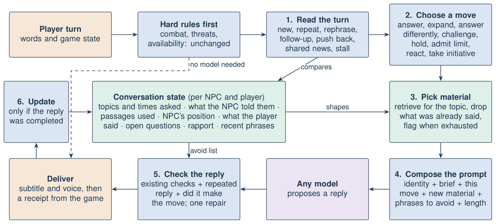

# I23: Conversations that develop

Status: proposed design, not implemented. The example replies below are illustrative, not system output.

## Goal

An NPC should follow the conversation as a person would. A repeated question should not get the same answer. A real attempt to continue should get somewhere. A player who keeps pushing should get a reaction. The prompt should change each turn to reflect what has already happened, and this should work with any model and game.

## Why NPCs repeat today

I asked the same question four times through the real pipeline, offline, and recorded each prompt.

| Part of the prompt | Turns 1 to 4 |
|---|---|
| System instructions | Byte-identical |
| Intent | `brief_reply` every time |
| Length limit | 18 words, one sentence, every time |
| Retrieved passages | The same three, every time |
| Instruction about repetition | None |
| History | Grows, and this is the only change |

So the model gets the same task and the same facts, and it answers the same way.

The same thing happened in live Skyrim on the merged code, on 2026-11-05:

| Player | Memory available | Whiterun Guard (real Gemini reply) | Game receipt |
|---|---|---|---|
| hello who are you | 0 exchanges | "I'm a guard of Whiterun, keep your hands to yourself." | Started, then interrupted |
| who are you | **0 exchanges** | "I am a guard of Whiterun, keeping the peace in these streets." | Started, then interrupted |

Memory stayed empty because only completed replies are saved, and both were interrupted within about a second. **While playback keeps being interrupted, the NPC cannot remember anything in-game, so this design cannot work there until that is fixed.** See P3 in the [goal gap review](../reviews/2026-11-05-goal-gap-review.md).

The rest of the pipeline adds to the repetition:

- **The policy has no view of the conversation.** It reads one utterance, so turn 5 is treated like turn 1.
- **Authored lines never vary.** In the study, the innkeeper said "You can be upset without taking it out on me." five times running.
- **Nothing tracks what was said.** History is raw text, with no record of topics, what the NPC has already revealed, or what the player told it.
- **The instructions push towards flat replies.** "Admit unknowns" and "no extra biography/judgments" encourage "I know nothing" and block opinions.
- **Short replies never open up.** A stranger stays limited to 18 words for the whole conversation.
- **Nothing rejects a repeat.** The validator accepts a reply identical to the last one.

## The workflow

The design adds one deterministic stage to the core, a **conversation director**, and makes no extra model call on a normal turn. Existing safety rules still run first, so combat, threats and availability are unchanged.

### 1. Read the turn

Compare the player's words with this conversation's earlier turns. The MiniLM encoder is already loaded and takes about 14 ms per sentence, so this adds no dependency. It also reduces reliance on English word patterns, which reached only 32% recall in the hostility test.

| Turn type | How to detect it |
|---|---|
| New topic | Low similarity to all earlier player turns |
| Repeat | Very high similarity to an earlier player turn |
| Rephrase | High similarity to an earlier turn, with different words |
| Follow-up | Short, with a reference to the last reply ("why?", "who told you that?") |
| Push back | Disagreement with the last reply ("are you sure?", "that can't be right") |
| Shared news | A statement, not a question, with new content |
| Stall | Very short, with little content ("ok", "hmm") |
| Return | Similar to a topic from several turns ago |

The thresholds must be calibrated on labelled examples; they cannot be assumed.

### 2. Conversation state

Stored per NPC and player, next to the existing relationship state in `SocialStore`.

| Field | What it holds |
|---|---|
| Topics | Each topic, times asked, and when it was last raised |
| Position | Per topic: knows, knows partly, heard a rumour, doesn't know, refuses |
| Told | Short record of each NPC reply and the passages behind it |
| Player said | The player's claims, kept as claims and never treated as facts |
| Open question | Anything the NPC asked that hasn't been answered |
| Rapport | How engaged this conversation is. Bounded, and separate from trust |
| Recent phrases | Openings and key phrases from recent replies |

**Rule:** only replies the game confirms as completed update this state. If a reply was interrupted, the player never heard it, so asking again is not a repeat. This matters while in-game playback is unreliable.

### 3. Choose a move

The move is what the NPC is trying to do this turn. It is chosen by rules from the turn type, state and persona, so it can be inspected and tested.

| Situation | Move | What the NPC does |
|---|---|---|
| New question, can answer | **Answer** | Gives a direct reply |
| Follow-up with unused material | **Expand** | Adds something new on this topic |
| Asked twice | **Answer differently** | Gives the point in new words, adds a detail, or asks what they're really after |
| Asked three times | **Challenge** | Notices the repetition: "You've asked me that already. Why does it matter so much?" |
| Keeps asking | **Close the topic** | Persona decides: a patient NPC redirects, an impatient one gets short or ends the talk |
| Repeat with a new angle or new information | **Reconsider** | Treats it as a real development |
| Valid push, nothing new to give | **Admit limit** | Says so, then offers an opinion, a rumour or who might know |
| Pressure for something restricted | **Hold** | Refuses, in a new way each time, and may grow suspicious |
| Player shares news | **React** | Responds to it, and remembers it as something the player said |
| Player answered the NPC's question | **Follow through** | Uses the answer |
| Player returns to an old topic | **Recall** | Refers back: "Like I told you before..." |
| Stalling | **Take initiative** | Raises a concern from its own goals, or ends the talk |

**Guardrail:** repetition never unlocks knowledge. Asking ten times changes how the NPC reacts, never what it knows. Access still depends only on the trusted source binding and authored state.

### 4. Pick material

- Build the retrieval query from the topic, so a vague "why?" still finds the right passages.
- Remove passages already used, and pass them as "already told them".
- If nothing new is left, mark the topic as exhausted. That drives **Admit limit** and stops the NPC inventing something to say.

### 5. Compose the prompt

The prompt is built fresh each turn. Identity and safety rules stay stable, and the rest changes.

| Section | Example on a third ask |
|---|---|
| Identity and limits | Unchanged |
| Conversation brief | "Turn 6. They have asked about the war plan 3 times. You said you know nothing, and passed on the harvest rumour." |
| This move | "Challenge: you notice they keep asking. React in character. Do not simply answer again." |
| New material | Only unused passages, or "nothing new on this" |
| Avoid | "Do not reuse: 'I only tend my barley fields', 'know nothing of'" |
| Length | Set by the move and rapport, so a stranger's reply can grow as the talk develops |

The instructions also need a change: allow in-character opinion and hearsay, clearly marked as such, while still barring invented facts.

### 6. Check the reply

Add two checks to the existing validator, using the existing two-call limit:

- **Repeated reply:** too similar to a recent NPC reply, or opening the same way.
- **Move not made:** for example, **Expand** that adds no new material.

If the repair also fails, use an authored fallback chosen by move and persona, never the same line twice in a conversation. Authored routes such as greetings and insult replies also draw on these pools, so they vary too.

## Example conversation

Illustrative replies for the peasant:

| Player | Read as | Move | Illustrative reply |
|---|---|---|---|
| What is the king's plan for the war? | New | Answer (rumour) | "Me? I work barley. Folk at the mill say he'll march before harvest, but that's just talk." |
| Why do they think that? | Follow-up | Expand | "Salt's gone dear, and the levy took two of our lads. Something's coming." |
| But what's the actual plan? | Rephrase | Answer differently | "Nobody tells farmers plans. You'd want someone from the keep." |
| Tell me the plan. | Third ask | Challenge | "You keep at this. Who are you, that it matters so much?" |
| I'm just worried about my family. | Shared news | React | "Aye. Mine too. Where are your people from?" |
| Near Dunmere. | Answered | Follow through | "Dunmere? Get them out if you can. The fighting's moved closer to the river." |

Compare this with today's flat "I know nothing of royal plans", repeated.

## Risks

| Risk | Mitigation |
|---|---|
| A valid rephrase is treated as nagging | Rephrase gets **Answer differently** first; **Challenge** needs repeated asks |
| Player farms rapport for secrets | Rapport affects length and warmth only, never knowledge or trust |
| The model ignores the move | The check catches it, with one repair, then a fallback |
| Long conversations overflow the prompt | The brief summarizes by topic, so it replaces most raw history |
| Replies feel random | Moves come from rules and stay visible in Inspect context |
| Save or reload confusion | State uses the existing scope, including save branch |
| Slower turns | Target under 30 ms added, to be measured |

## How to know it worked

Build a conversation test set first, and measure today's system as the baseline.

| Measure | Target |
|---|---|
| Repeated replies across a conversation | Well below the baseline |
| Correct turn type | Precision and recall on labelled, unseen conversations |
| Correct move, offline | All scripted cases, with fake models |
| Restricted knowledge unlocked by repetition | Zero |
| Added processing time | Under 30 ms |
| Human rating, real conversations | Blinded comparison with the baseline |

Live model runs and the human study need separate approval, since they use API quota and people's time.

## Build order

0. **Prerequisite:** fix in-game playback (P3), or nothing is remembered in-game. The lab can develop stages 1 to 4 meanwhile, because it does not depend on game receipts.
1. **Baseline:** conversation test set and repetition measure.
2. **State and turn reading:** `src/npc/context/conversation.py`, contracts and store changes. Observed only, with no behaviour change.
3. **Moves and dynamic prompt:** `src/npc/behavior/moves.py` and `src/npc/generation/prompt.py`.
4. **Reply checks and line pools:** `src/npc/validation/response.py` and persona fixtures.
5. **Wire up and evaluate:** connector and lab, Inspect context, then live and human tests.

Each stage follows the repository's plan, review, test and regression workflow. Later work, not in this plan: NPCs sharing news with each other, and long-term memory across sessions.

## Plan self-review

Labelled self-review, not an independent one. The main assumption to test is that embedding similarity separates repeats from real follow-ups; stage 2 tests this before behaviour depends on it. An alternative is to ask the model to classify each turn, but that costs a call or adds latency, and would tie behaviour to the model, so it stays a fallback. I22's rule that only completed receipts commit memory is preserved.
